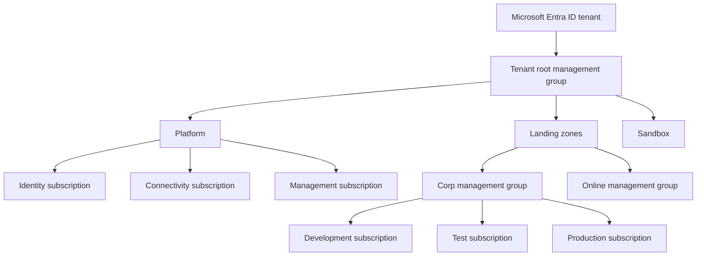
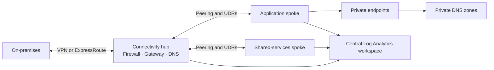

# Azure Landing Zone Lab

A learning-oriented reference for Azure governance, identity, network topology, and centralized operations. The diagrams and policy sample are conceptual examples; this repository does **not** deploy an enterprise landing zone.

## Management group and subscription hierarchy

Place subscriptions according to ownership, policy needs, operational boundaries, and billing requirements. Use separate subscriptions for environments when the isolation and governance model requires it; do not treat a diagram as an applied tenant configuration.

## Identity and access management

- Use Microsoft Entra ID groups for role assignment rather than assigning users individually.
- Apply least privilege at the narrowest practical scope: management group, subscription, resource group, or resource.
- Prefer managed identities for Azure workloads and workload identity federation for automation.
- Use Privileged Identity Management for eligible, time-bound elevated access where licensed and configured.
- Separate platform administration from workload operations; review access regularly and remove stale assignments.
- Avoid Owner or Contributor grants at tenant/root scope unless explicitly justified and governed.

| Persona | Example access pattern | Notes |
| --- | --- | --- |
| Platform network operator | Network Contributor on connectivity resources | No broad identity administration |
| Workload contributor | Contributor on a workload resource group | No role-assignment or policy authority |
| Security auditor | Reader/Security Reader at approved scope | Read-only assessment |
| Pipeline identity | Specific deployment roles at a target scope | Federated identity; no stored client secret |

The table is illustrative; validate built-in role permissions against current Azure documentation and your organization's controls.

## Azure Policy example

[`policies/require-environment-tag.json`](policies/require-environment-tag.json) is an **unassigned** policy-definition example that audits missing `environment` tags. Review and test policy effects, exemptions, and remediation before assigning policies to any management group.

## Hub-and-spoke reference

### Design notes

- Plan non-overlapping IP ranges before peering. Use an IPAM source of truth.
- Route traffic through the firewall only when the routing, availability, and inspection requirements are defined and tested.
- Link private DNS zones deliberately to VNets that need name resolution; avoid duplicate zone ownership.
- Use Private Endpoints for selected PaaS services when required by the threat model. Plan DNS and egress paths as part of the design.
- Centralize diagnostic settings and monitoring, while controlling data collection, retention, access, and cost.
- Separate development, test, and production through subscription boundaries and policy/role assignments appropriate to the organization.

## Governance and operations checklist

- **Identity:** group-based RBAC, managed identities, time-bound privileged access, access reviews
- **Policy:** audit before deny, documented exemptions with owners and expiry, policy-as-code review
- **Network:** address planning, segmentation, controlled ingress/egress, private DNS, flow visibility
- **Observability:** diagnostic settings, Log Analytics access controls, retention, alerts and ownership
- **Resilience:** workload-specific backup, recovery objectives, restore tests, regional dependency review
- **FinOps:** budget alerts, tags/cost ownership, rightsizing, non-production schedules, ingestion review

## Validation and use

This lab intentionally contains no subscription/management-group deployment code. The JSON policy file can be reviewed with the Azure Policy definition schema and tested in a non-production scope before assignment. Never assign policy or alter tenant-level access based solely on this learning reference.

## Further study

- Azure landing-zone design areas: identity, management, connectivity, and security
- Azure Policy initiatives, exemptions, and compliance reporting
- Hub-spoke versus Virtual WAN and workload-specific network topologies
- Private Link, DNS forwarding, Azure Monitor Agent, and Data Collection Rules
- Subscription vending, policy-as-code, and controlled environment promotion
